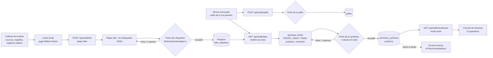

# Plan de mise en œuvre : outils stratégiques (étiquettes, tableau stratégique, synthèses)

*Établi le 26 octobre 2026, après le scénario C de la réorientation vers la veille stratégique. Les coûts non mesurés sont marqués « estimé », avec leur base. Questions tranchées par l'opératrice le 26 octobre 2026 : voir le §8 ; le lot 0 est fait le même jour.*

## 1. Résumé

1. **Une seule voie d'écriture : les routes du portail.** Les tâches proposent (JSON à schéma fixe), le portail contrôle (porte en code) puis enregistre dans Postgres. C'est le schéma déjà en service pour les lettres (`POST /api/veille/resultat`, `lib/portail/file.ts:117`) et il sert Cowork comme l'API.
2. **Stockage dans Postgres, sans texte de lettre** : quatre tables (`faits_etiquetes`, `grilles`, `elements_synthese`, `positions`). Un fait étiqueté est désigné par son édition, sa section, son rang et l'empreinte de sa phrase-titre ; son texte reste dans Notion. Aucune base Notion nouvelle, donc aucune extension de l'intégration du portail au-delà de « Éditions » et « Accès ».
3. **Portes pures dans `lib/domaine/strategie.ts`**, orchestration dans `lib/portail/strategie.ts`, accès base dans `lib/base/strategie.ts`, trois routes à un seul segment (`/api/veille/faits`, `/api/veille/grille`, `/api/veille/syntheses`), seules admises par la garde du harnais (`scripts/taches/garde.ts:147`).
4. **Chaque semaine** : une étape « étiquettes » ajoutée à la page des lettres, après la validation par le portail (étape 4bis), **non bloquante** pour l'envoi.
5. **Chaque mois et chaque trimestre** : une section « Synthèse stratégique » ajoutée à la page de la revue mensuelle, qui lit les faits étiquetés du mois écoulé ; le trimestriel est une sous-section active en janvier, avril, juillet et octobre. Pas de sixième tâche.
6. **Les chiffres sont calculés par le portail lui-même** (indice de cycle de vie, benchmark) au moment de recevoir la synthèse ; le modèle n'écrit que l'interprétation.
7. **La grille vit dans le référentiel** (une section courte, non numérotée, après le §2), et le portail en tient une copie versionnée par empreinte, re-postée par la revue avant chaque synthèse.
8. **Rien au portail pendant le pilote** : la synthèse est relue par l'opératrice dans le courriel « [Relecture] » de la revue. Après le pilote : « Acteurs » (carte, Mendelow), « Recommandations » (SWOT, TOWS) et une **vue PESTEL dédiée** (décision du 26/10/2026), dont la forme se tranche au lot 11.
9. **Pilote sur huit semaines**, du 2 novembre au 27 décembre 2026 : Mastora et Infralliance d'abord **étiquetées après coup** sur leurs lettres déjà écrites (aucune lettre produite pour le pilote), puis Infralliance étiquetée chaque mercredi dans sa tâche des lettres.
10. **Premier lot** : le domaine et les portes, testés sur une lettre réelle récente étiquetée à la main.

## 2. Écarts constatés entre les sources et la demande

| Écart | Source | Conséquence pour le plan |
|---|---|---|
| La page de la revue mensuelle n'a pas été révisée le 26/10/2026 (dernière modification le 21/10). Elle cite encore le §4 dans sa table de répartition et au contrôle 3 (« Ouvre chaque URL des §1 et §4 »), et ne dit rien des familles mensuelles. | Notion, page 3d5fe829ce71819ba0d0ce67d742d652 | Lot 0 ajouté : réviser la revue avant d'y greffer la synthèse. |
| La revue tourne **la veille** de la première parution du mois ; les familles mensuelles sont collectées **par** cette première lettre, le lendemain. La revue du mois M ne peut donc lire que les familles mensuelles collectées au mois M-1. | Revue, porte ; page des lettres, point g bis | Fenêtre de la synthèse fixée de première parution à première parution (mois M-1 complet). Les familles mensuelles y entrent, avec un mois de décalage assumé et écrit dans la synthèse. |
| Le validateur compte comme faits les lignes de toute rubrique dont le titre commence par « Signaux » (`lib/portail/lint.ts:205`). La rubrique « Signaux de rupture », qui ne fait que reprendre des faits, gonfle donc le compte de l'édition n°1. | Code | Lot 1 : exclure « Signaux de rupture » du compte et de l'étiquetage. |
| Les lettres de septembre gardées comme exemples dans les tests n'ont pas de phrases-titres en gras (`tests/fixtures/lettre-reelle.ts`, `tests/fixtures/lettre-concurrentielle.ts` : aucun segment gras). La structure « phrase-titre en gras » date de la révision du §6 du 19/10/2026. | Code | Lot 1 : la segmentation des faits gère les deux formes, et une nouvelle fixture est tirée d'une lettre d'octobre. |
| « Fournisseurs : non suivi faute de famille » n'est pas toujours vrai : le catalogue du §1 porte une famille « coûts d'intrants et dépendances ». | Notion, prompt de génération, §1 révisé le 26/10 | La force « pouvoir des fournisseurs » est « non suivi » seulement quand la grille ne lui associe aucune famille. |
| Les critères FAIBLE restent dans les référentiels de Konica et Dalious (décision de l'opératrice du 26/10). | Référentiels | Sans effet sur les étiquettes : un fait n'a jamais que FORT ou MOYEN (le contrat de forme interdit FAIBLE dans la lettre). Les crans des outils n'emploient jamais ce mot. |
| La règle « Postgres ne contient jamais le texte d'un référentiel » (`docs/schema-donnees.md`, « Ce qui va où ») couvre mal deux cas : les libellés courts de la grille et les énoncés de synthèse. | CLAUDE.md, schéma | Recommandation argumentée (§3.2) et deux questions fermées (§8). |

## 3. Décisions recommandées

### 3.1 Modèle de données

Conventions du schéma existant : `uuid` générés par la base, `timestamptz`, noms en français, suppression jamais physique (`archivée_le`). Clé de cloisonnement : `organisation_id` (référence `organisations.id`) sur chaque ligne, et jamais de lecture sans elle.

#### Listes fermées

| Liste | Valeurs | Remarque |
|---|---|---|
| `pestel` | `politique`, `economique`, `socioculturel`, `technologique`, `ecologique`, `legal` | Environnement (référentiel écosystème surtout) |
| `force_porter` | `rivalite`, `nouveaux_entrants`, `substituts`, `pouvoir_clients`, `pouvoir_fournisseurs` | Concurrence |
| `ansoff` | `penetration`, `developpement_produit`, `developpement_marche`, `diversification` | Seulement pour un fait qui nomme un concurrent (force `rivalite` ou `nouveaux_entrants`) |
| `section` | `axe`, `acteurs` | Les faits des axes et de « L'actualité des acteurs » ; jamais « L'essentiel », « Signaux de rupture » ni « Analyse », qui reprennent des faits |
| `impact` | `FORT`, `MOYEN` | Un fait d'axe RAS n'est pas étiqueté |
| `nouveauté` | `nouveau`, `contexte` | « élément de contexte, non nouveau » |
| `outil_synthese` | `pestel`, `swot`, `tows`, `scenario`, `indice_cycle`, `benchmark`, `ge` | `ge` : matrice McKinsey/GE, annuelle |
| `case_swot` | `forces`, `faiblesses`, `opportunites`, `menaces` | |
| `état_d_element` | `nouveau`, `renforce`, `inchange`, `affaibli` | |
| `origine` | `faits`, `declaratif` | `declaratif` admis seulement pour `forces` et `faiblesses`, et alors `hypothèse` est vrai tant que le point de validation n'est pas répondu |
| `type_tows` | `SO`, `ST`, `WO`, `WT` | |
| `outil_position` | `groupes`, `mendelow`, `forces`, `ge` | |
| crans de Mendelow | 1 `bas`, 2 `intermediaire`, 3 `eleve` | pour le pouvoir et l'intérêt ; jamais « faible » ni « fort », pour ne pas se confondre avec l'impact |
| crans des 5 forces | 1 `contenue`, 2 `marquee`, 3 `intense`, et `non_suivi` | |
| `tendance` | `hausse`, `stable`, `baisse` | 5 forces |
| crans des groupes stratégiques | 1 à n, n de 3 à 5 par axe, chaque cran avec un critère écrit dans la grille | |
| `état_de_publication` | `propose`, `publie`, `retire` | `propose` pendant le pilote |

#### Objet 1 : Fait étiqueté (`faits_etiquetes`)

| Champ | Type | Règle |
|---|---|---|
| `id` | uuid | |
| `organisation_id` | uuid | celle de l'édition, vérifiée par la relation Organisation (règle 2) |
| `edition_notion` | text | identifiant de la page Édition |
| `famille_edition` | text | `ecosysteme` ou `concurrentiel` (propriété interne lue par `lireÉditionDeTravail`, `lib/notion/travail.ts:77`) |
| `date_edition` | date | |
| `section` | enum `section` | |
| `numero_axe` | smallint, nullable | requis si `section = axe` |
| `rang` | smallint | rang du fait dans sa section, à partir de 1 |
| `empreinte_titre` | char(8) | empreinte de la phrase-titre normalisée, calculée par le portail ; le texte n'est pas conservé |
| `date_fait` | date | ≤ date d'édition |
| `source_url` | text | doit figurer dans les blocs du fait |
| `pestel` | enum, nullable | exactement un de `pestel` ou `force_porter` |
| `force_porter` | enum, nullable | |
| `ansoff` | enum, nullable | requis si le fait nomme un concurrent et que la force est `rivalite` ou `nouveaux_entrants`, interdit sinon |
| `entite` | text ≤ 120, nullable | nom de l'entité du §2 que le fait concerne ; doit figurer dans la grille si elle porte des entités |
| `rupture` | boolean | touche Q3 |
| `impact` | enum `impact` | ≤ niveau de l'axe |
| `nouveaute` | enum | |
| `run_id` | uuid, nullable | lien vers `runs` quand l'exécuteur en a un |
| `créé_le`, `archivée_le` | timestamptz | |
| unicité | | (`edition_notion`, `section`, `numero_axe`, `rang`) |

Cycle de vie : un lot remplace les étiquettes précédentes de la même édition (archivage des anciennes, insertion des nouvelles, dans une transaction). Une édition remise en Brouillon puis corrigée est simplement ré-étiquetée.

#### Objet 2 : Grille de l'organisation (`grilles`)

| Champ | Type | Règle |
|---|---|---|
| `id` | uuid | |
| `organisation_id` | uuid | |
| `version` | integer | croissante |
| `empreinte` | char(8) | empreinte du JSON normalisé ; un re-post identique ne crée pas de version |
| `referentiel_notion` | text | page du référentiel qui porte la grille |
| `axes_groupes` | jsonb | deux axes : `{ clé, libellé ≤ 40, crans: [libellé ≤ 40] }`, 3 à 5 crans ; les critères complets restent dans Notion |
| `familles` | jsonb | `[{ numéro, veille, pestel ou force_porter, cadence }]` : la correspondance famille vers PESTEL ou Porter, d'où les trous du PESTEL |
| `entites` | jsonb | `[{ nom, siren ou null, groupe stratégique ou null }]`, 40 au plus par veille |
| `parties_prenantes` | jsonb | 8 à 15 : `[{ nom ≤ 80 }]` |
| `offres` | jsonb, nullable | pour la matrice GE, seulement si la fiche porte plusieurs offres |
| `validée_le` | timestamptz, nullable | quand les points de validation des axes sont répondus |
| `créée_le`, `archivée_le` | timestamptz | |
| unicité | | (`organisation_id`, `version`) |

#### Objet 3 : Élément de synthèse (`elements_synthese`)

| Champ | Type | Règle |
|---|---|---|
| `id` | uuid | |
| `organisation_id` | uuid | |
| `periode` | text | `AAAA-MM` (mensuel) ou `AAAA-T1` à `T4` (trimestriel) ou `AAAA` (annuel) |
| `fenetre_debut`, `fenetre_fin` | date | de première parution à première parution |
| `outil` | enum `outil_synthese` | |
| `cle` | text ≤ 40 | `forces`, `SO`, `pestel:legal`, `scenario-1`… |
| `rang` | smallint | |
| `enonce` | text ≤ 240 | interprétation écrite par le modèle |
| `etat` | enum, nullable | SWOT |
| `origine` | enum `origine` | |
| `hypothese` | boolean | |
| `filiation` | uuid, nullable | l'élément du mois précédent qu'il prolonge (renforcé, inchangé, affaibli) |
| `faits` | uuid[] | au moins un fait de l'organisation, sauf `origine = declaratif` |
| `references` | jsonb | éléments SWOT croisés (TOWS), indicateurs (scénario), section de fiche (déclaratif) |
| `valeur` | jsonb, nullable | chiffres calculés par le portail (indice, benchmark) ; jamais fournis par le modèle |
| `candidate_recommandation` | boolean | TOWS : une seule par période |
| `grille_version` | integer | version de la grille au moment de la synthèse |
| `etat_publication` | enum | |
| `créé_le`, `archivée_le` | timestamptz | |
| unicité | | (`organisation_id`, `periode`, `outil`, `cle`, `rang`) parmi les lignes non archivées |

#### Objet 4 : Position en crans (`positions`)

| Champ | Type | Règle |
|---|---|---|
| `id` | uuid | |
| `organisation_id` | uuid | |
| `periode` | text | |
| `outil` | enum `outil_position` | |
| `sujet` | text ≤ 80 | entité (groupes), partie prenante (Mendelow), force (5 forces), offre (GE) ; doit figurer dans la grille |
| `axe` | text ≤ 40 | clé d'axe de la grille, ou `pouvoir`, `interet`, `intensite` |
| `cran` | smallint, nullable | dans les bornes de l'axe ; nul si `non_suivi` |
| `non_suivi` | boolean | |
| `tendance` | enum, nullable | 5 forces |
| `faits` | uuid[] | au moins un ; un changement de cran par rapport à la période précédente exige un fait de la fenêtre qui nomme le sujet |
| `grille_version` | integer | |
| `etat_publication` | enum | |
| `créé_le`, `archivée_le` | timestamptz | |
| unicité | | (`organisation_id`, `periode`, `outil`, `sujet`, `axe`) non archivées |

Et un drapeau : `organisations.outils_strategiques` (boolean, défaut faux). Les routes répondent `hors-pilote` tant qu'il est faux ; les pages Notion disent de passer l'étape sur cette réponse. C'est ce qui borne le pilote sans propriété nouvelle dans le registre.

### 3.2 Stockage : Postgres, pas de base Notion nouvelle

**Recommandation : tout dans Postgres, rien de nouveau dans Notion, sauf la section « Grille stratégique » du référentiel.**

| Critère | Base Notion « Faits étiquetés » et page « Tableau stratégique » | Tables Postgres |
|---|---|---|
| Porte avant écriture | Impossible au portail, qui n'écrit jamais dans Notion : la porte vivrait dans le harnais, que Cowork n'a pas | La porte est dans la route, la même pour Cowork et l'API |
| Débit et coût | Chaque fait est une écriture MCP par le modèle : environ 15 à 25 lignes par lettre (estimé, base : 2 à 4 faits par axe sur 5 à 7 axes, §6 du prompt) | Un appel de route par lettre |
| Affichage au portail | Exige de partager une base de plus avec l'intégration, contre la règle actuelle des deux bases | Lecture par `lib/base/`, sans lecture Notion supplémentaire hors des corps déjà en cache |
| Cloisonnement | Filtre par relation à écrire à chaque requête | `organisation_id` sur chaque ligne, unicité et contraintes en base |
| Unicité, transactions | Absentes de l'API Notion (cause des incidents de septembre, `docs/decision-portail-moteur.md`) | En base |

Ce qui ferait changer d'avis : une décision de lire et commenter les synthèses dans Notion plutôt que par courriel ou au portail. La règle « Postgres ne contient jamais le texte d'un référentiel » est tenue : les faits ne gardent qu'une empreinte ; les énoncés de synthèse sont une analyse nouvelle, ni corps de lettre ni texte de référentiel ; la grille ne recopie que des libellés de 40 caractères au plus. Ces deux interprétations ont reçu l'accord de l'opératrice le 26/10/2026 (§8, décisions 1 et 2).

### 3.3 Les portes en code

| Où | Quoi |
|---|---|
| `lib/domaine/strategie.ts` | Listes fermées, types, et trois fonctions pures : `contrôlerLesÉtiquettes(document, lot)`, `contrôlerLaGrille(grille)`, `contrôlerLaSynthèse(synthèse, contexte)`. Aucune importation de `lib/notion` ni de `lib/base`. |
| `lib/domaine/document.ts` | `segmenterLesFaits(axe ou rubrique)` : un fait commence à un paragraphe entièrement en gras (forme du §6 depuis le 19/10/2026) ; sans phrase-titre en gras (lettres plus anciennes, lettre unique du moteur), chaque bloc de fait (`faitsDe`, `lib/domaine/document.ts:468`) est un fait. |
| `lib/portail/strategie.ts` | Orchestration : lit l'édition (`lireÉditionDeTravail`, `lireBlocsDePage`, déjà utilisés par la route du lint, `app/api/veille/lint/route.ts:51-59`), vérifie l'organisation, appelle la porte, écrit par `lib/base/strategie.ts`. |

**Porte des étiquettes**, codes rendus : `edition-introuvable`, `organisation-différente`, `hors-pilote`, `section-inconnue`, `fait-introuvable` (rang au-delà des faits de la section), `titre-différent` (la phrase-titre envoyée ne correspond pas, normalisée, à celle de la lettre), `axe-ras`, `étiquette-inconnue`, `cadre-ambigu` (ni ou à la fois PESTEL et Porter), `ansoff-manquant`, `ansoff-hors-concurrent`, `impact-supérieur-à-l-axe`, `date-future`, `source-absente` (l'URL n'est pas dans les blocs du fait), `entité-hors-grille`, `lot-incomplet` (un fait d'axe non RAS ou de la rubrique des acteurs sans étiquette), `doublon`.

**Porte de la grille** : deux axes, 3 à 5 crans chacun ; 8 à 15 parties prenantes ; chaque famille du référentiel rattachée à une lettre PESTEL ou à une force ; SIREN à neuf chiffres ou nul ; 40 entités au plus par veille ; aucun libellé « faible ».

**Porte de la synthèse** : `fait-inconnu` (identifiant hors de l'organisation), `fait-hors-fenêtre`, `case-hors-bornes` (3 à 5 éléments par case SWOT, ou moins avec la mention `insuffisant` quand la fenêtre ne porte pas trois faits distincts : la porte ne force jamais un remplissage), `tows-hors-bornes` (2 à 4), `tows-sans-croisement` (une option cite au moins un élément interne et un externe), `candidate-unique`, `état-inconnu`, `filiation-inconnue`, `déclaratif-hors-forces-faiblesses`, `hypothèse-non-marquée`, `position-hors-grille`, `cran-hors-bornes`, `mouvement-sans-fait`, `grille-périmée` (version différente de la dernière postée), `vocabulaire-interdit` (« FAIBLE », « référentiel », « § », comme `lib/moteur/portes.ts:24-31`), `longueur`. En avertissement seulement : `spécificité` (un énoncé qui ne porte ni nom de la grille, ni chiffre, ni date). La spécificité réelle se juge à la relecture : le code ne sait pas dire qu'une phrase resterait vraie pour un concurrent.

**Réponse en cas de refus** : statut 422 et la liste `[code] message`, sur le modèle de `messageDeReprise` (`lib/moteur/portes.ts:107`). **Deux reprises au plus**, comme le moteur ; au-delà, la tâche consigne l'échec au compte rendu et continue. **Les étiquettes ne bloquent jamais l'envoi d'une lettre**, et une synthèse refusée ne bloque jamais la revue.

### 3.4 Le point d'entrée de Claude : une voie par temps

| Temps | Voie | Pourquoi |
|---|---|---|
| Initial (pilote) | Revue mensuelle en « mode initial » : grille, PESTEL, SWOT et positions de départ | Les organisations du pilote sont déjà équipées ; l'onboarding n'est pas en cause |
| Initial (après le pilote) | Page d'onboarding : grille à l'étape A (référentiels), synthèse initiale à l'étape B (première lettre) | L'agent qui profile l'organisation a déjà tout en main |
| Chaque semaine | Page des lettres, étape « 4ter étiquettes », par `appeler_portail` (`scripts/taches/outils.ts`) ou l'appel direct sur Cowork | L'agent qui a écrit les faits connaît leurs sources et leurs acteurs ; aucun rechargement de la lettre ; aucun outil nouveau, puisque la route fait la porte |
| Chaque mois | Page de la revue, section « Synthèse stratégique » | La revue lit déjà les éditions du mois (étape 0.3) et écrit l'ordre du jour de relecture (étape 3.3) |
| Chaque trimestre | Même section, sous-section active en janvier, avril, juillet, octobre | Pas de sixième tâche, pas de pointeur ni de récurrence de plus |

Pourquoi pas un outil du harnais sur le modèle de `deposer_courriel` : il n'existerait que sur l'API, alors que les lettres des clients tournent encore sur Cowork ; et il dupliquerait une porte qui doit vivre au portail. Pourquoi pas le moteur en code : il n'est pas en service. Le schéma de `lib/domaine/strategie.ts` est écrit pour qu'il le reprenne plus tard : les étiquettes s'ajouteront aux faits de `schémaDeLaLettre` (`lib/moteur/redaction.ts:20`).

Ce qui ferait changer d'avis sur l'étape hebdomadaire : un coût d'étiquetage dans la lettre supérieur à 0,50 $ par lettre une fois mesuré ; on passerait alors à une passe séparée sur Sonnet, qui relit l'édition publiée.

### 3.5 Le trimestriel

**Section de la revue**, conformément à la recommandation par défaut. Une organisation hebdomadaire a douze revues par an, dont quatre trimestrielles ; la porte de la revue (`revuesDues`, `lib/domaine/calendrier.ts:209`) donne déjà le bon jour. La sous-section produit : intensité des cinq forces (crans et tendance, `non_suivi` quand aucune famille ne porte la force), trois scénarios sur Q3 avec deux à quatre indicateurs chacun (une famille du §1 et un signal datable), interprétation de l'indice de cycle de vie et du benchmark, que le portail a calculés. La matrice GE est annuelle (revue de janvier), seulement si la grille porte au moins deux offres.

### 3.6 L'affichage

Pendant le pilote, **rien au portail**. La route `GET /api/veille/syntheses` rend la synthèse en texte ; la revue l'insère dans le courriel « [Relecture] » envoyé à l'opératrice (étape 3.3). Rien ne va au client.

Après le pilote, parmi les sept écrans :

| Écran | Ce qu'il reçoit | Pourquoi |
|---|---|---|
| Acteurs (`/[slug]/acteurs`) | Carte des groupes stratégiques et Mendelow | Il répond à « qui bouge » ; il ne lit aucun corps de note, les positions non plus |
| Recommandations | SWOT et TOWS, l'option candidate en tête | La TOWS nourrit la recommandation de la lettre suivante |
| Vue PESTEL dédiée (décision du 26/10/2026) | Les six lettres PESTEL, les familles qui les couvrent, les trous, et les faits étiquetés du trimestre | Forme à trancher au lot 11 : soit un onglet dans la page « Les axes » (même adresse, aucune route nouvelle), soit un écran `/[slug]/pestel`, huitième écran, à inscrire dans `CLAUDE.md`. Jamais `/[slug]/axes/pestel` : ce segment masquerait l'axe d'un client nommé « PESTEL », exactement la leçon des segments variables écrite dans `CLAUDE.md` |

Les écrans existants appellent déjà `exigerLectureComplète` (une vue PESTEL l'appellera aussi) ; `tests/architecture.test.ts` (bloc « chaque écran de l'espace obéit au droit de lecture », ligne 798) couvre la règle.

## 4. Architecture

| Pièce | Où | Nouvelle ou étendue |
|---|---|---|
| Listes, types, portes pures | `lib/domaine/strategie.ts` | nouvelle |
| Segmentation des faits | `lib/domaine/document.ts` | étendue |
| Exclusion de « Signaux de rupture » du compte des faits | `lib/portail/lint.ts:205` | étendue |
| Tables et accès | `lib/base/schema.ts`, `lib/base/strategie.ts`, `drizzle/0013_outils_strategiques.sql` | nouvelle (migration) |
| Orchestration | `lib/portail/strategie.ts` | nouvelle |
| Routes | `app/api/veille/faits`, `app/api/veille/grille`, `app/api/veille/syntheses` | nouvelles, gardées par `refuserSiNonAutorisé` (`lib/portail/garde-veille.ts:13`) |
| Calculs BODACC et fiches | `lib/registres/` (déplacé depuis `scripts/collecte/registres.ts`, ré-exporté pour le harnais) | déplacée |
| Mesure de l'étape | `scripts/taches/executer.ts`, `scripts/taches/mesure.ts`, `lib/moteur/cout.ts` | étendues |
| Contrôle du soir | route `etat` | étendue : éditions du pilote sans étiquettes |
| Section « Grille stratégique » | prompt de génération (Notion), référentiels du pilote | étendue |
| Étape 4ter | page des lettres (Notion) | étendue |
| Section « Synthèse stratégique » | page de la revue (Notion) | étendue |
| Grille et synthèse initiale | page d'onboarding (Notion), après le pilote | étendue |

## 5. Lots de travail, dans l'ordre

Chaque lot se livre seul, testé, sur une branche et une PR. Pour chaque page Notion amendée, le texte d'origine est recopié dans le journal de la page, comme le 26/10/2026, pour revenir en arrière.

### Lot 0. Remettre la revue au niveau du scénario C (fait le 26/10/2026)

- **Notion** : page de la revue, table de répartition (« · §4 · » retiré), contrôle 3 (« des §1 et §4 » devient « du §1 »), ajout au contrôle 4 : « une famille mensuelle ne se juge que sur les premières parutions du mois ».
- **Tests** : aucun (pas de code).
- **Fin** : la page ne cite plus le §4 ; note de révision datée en tête de page, textes d'origine recopiés. Fait le 26/10/2026 ; une phrase de plus au contrôle 3 dit quoi vérifier pour les deux familles des registres publics, qui n'ont pas d'URL.
- **Hors du lot** : toute synthèse.

### Lot 1. Le domaine et les portes, testés sur une lettre réelle

- **Fichiers** : `lib/domaine/strategie.ts` (nouveau), `lib/domaine/document.ts` (`segmenterLesFaits`), `lib/portail/lint.ts` (exclusion de « Signaux de rupture »), `tests/fixtures/lettre-octobre.ts` (nouvelle fixture, tirée d'une lettre publiée après le 19/10/2026, avec phrases-titres en gras), `tests/fixtures/etiquettes-octobre.ts` (étiquettes posées à la main par l'opératrice ou par moi, relues par elle), `tests/strategie.portes.test.ts`.
- **Tests** : la segmentation trouve le bon nombre de faits sur les deux formes (fixtures de septembre et d'octobre) ; le lot à la main passe la porte ; chaque code de refus a un cas qui le déclenche ; la grille et la synthèse ont leurs cas limites (case insuffisante, mouvement sans fait, déclaratif hors F et W).
- **Fin** : `pnpm test`, `pnpm lint`, `pnpm typecheck` passent ; l'opératrice a relu l'étiquetage de la fixture. Fait le 26/10/2026 : les onze étiquettes de la lettre d'octobre d'Infralliance sont validées telles quelles.
- **Hors du lot** : base, routes, Notion.

### Lot 2. La base

- **Fichiers** : `lib/base/schema.ts`, `drizzle/0013_outils_strategiques.sql` (générée par `pnpm base:generer`, relue), `lib/base/strategie.ts`, `docs/schema-donnees.md`.
- **Tests** : PGlite (`tests/aide/base-en-memoire.ts`) : contraintes d'unicité, remplacement d'un lot en transaction, aucune lecture sans `organisation_id` ; `tests/architecture.test.ts` : `lib/base/strategie.ts` n'est appelé que par `lib/portail/strategie.ts` (frontière nouvelle), et le schéma part avec le code (bloc ligne 893).
- **Fin** : migration appliquée en local et dans les tests ; la production la recevra au build (`scripts/base-migrer.ts --deploiement`).
- **Hors du lot** : routes.

### Lot 3. La route des faits

- **Fichiers** : `app/api/veille/faits/route.ts` (POST d'un lot, GET de la fenêtre d'une organisation, avec la phrase-titre relue en cache pour la revue), `lib/portail/strategie.ts`, `docs/api-veille.md`.
- **Tests** : route avec Notion simulé : `hors-pilote`, `organisation-différente`, refus puis acceptation, remplacement ; architecture : la route appelle `refuserSiNonAutorisé` avant toute lecture ; les lectures Notion passent par les fonctions cachées existantes (règle 1, bloc ligne 40).
- **Fin** : un lot réel posté sur l'aperçu Vercel est accepté.
- **Hors du lot** : la page des lettres.

### Lot 4. L'étiquetage après coup, puis l'étape hebdomadaire

- **Notion** : page des lettres, étape « 4ter ÉTIQUETTES » après 4bis : construire le lot (une entrée par fait d'axe non RAS et de la rubrique des acteurs : section, axe, rang, phrase-titre telle qu'écrite, date, URL, PESTEL ou Porter, Ansoff si concurrent, entité, rupture, impact, nouveauté), `POST /api/veille/faits`, deux reprises au plus, `hors-pilote` : passer ; l'échec ne bloque pas l'étape 5 ni l'envoi. Étape 1bis inchangée.
- **Étiquetage après coup** (décision du 26/10/2026, aucune lettre produite pour le pilote) : une passe lancée à la main relit des éditions déjà écrites et poste leurs étiquettes par la même route. Mastora : ses deux éditions n°1. Infralliance : ses éditions depuis la n°1 (septembre et octobre), ce qui éprouve la segmentation sur les deux formes. La passe tourne sur l'API avec la tâche des lettres limitée à l'organisation et une consigne d'étiquetage seul, ou dans une session de travail ; elle n'écrit rien dans Notion.
- **Code** : `organisations.outils_strategiques` posé à vrai pour Mastora et Infralliance (route PATCH existante de `/api/veille/organisations`, étendue) ; contrôle du soir : éditions du pilote sans étiquettes, à partir de la première étiquetée chaque semaine.
- **Tests** : la route PATCH accepte le drapeau ; le contrôle du soir compte les éditions non étiquetées.
- **Fin** : les éditions passées des deux organisations étiquetées et acceptées, puis la première lettre d'Infralliance étiquetée dans sa tâche du mercredi.
- **Hors du lot** : grille, synthèse.
- **Fait le 26/10/2026** : action `outils` de la route PATCH, défaut `étiquettes-manquantes` du contrôle du soir, étape 4ter dans la page des lettres (porte du pilote par `GET /api/veille/faits`, journal de la page complété), tâche `etiquetage` du harnais pour la passe après coup (choix : l'API, sur Sonnet 5.5, plafond 10 $). Restent, après déploiement : poser le drapeau de Mastora et d'Infralliance, lancer la passe sur chacune, puis constater l'étiquetage de la lettre d'Infralliance du mercredi. Passe du 26/10/2026 : Infralliance, 7 éditions sur 12 acceptées (57 faits, 1,74 $) ; les écosystèmes des 30/09, 07/10 et 14/10 refusés par un défaut de comparaison des URL (`%2F` rendu par l'API Notion), corrigé ; accord avec le lot validé du 21/10 : 6 cadres sur 11, 11 impacts sur 11, aucune rupture ni force de Porter, d'où un calibrage de l'étape 4ter à valider. Décisions de l'opératrice du même jour : les deux lettres du 08/09, sans source citée dans leurs faits, restent sans étiquettes ; Mastora, qui n'a aucune édition publiée, est étiquetée sur ses deux brouillons n°1 (consigne de la tâche `etiquetage` étendue aux brouillons d'une organisation sans édition publiée).

### Lot 5. La grille

- **Fichiers** : `app/api/veille/grille/route.ts`, porte de grille déjà écrite au lot 1.
- **Notion** : prompt de génération, phase 3 : section « Grille stratégique » non numérotée après le §2 (deux axes de groupes stratégiques à 3 à 5 crans, chacun avec son critère ; 8 à 15 parties prenantes ; correspondance famille vers PESTEL ou force ; offres si plusieurs), en dix lignes au plus, hors budget de mots comme le §6 ; phase 5, livrable B : les axes de la carte et les forces et faiblesses déterminantes entrent dans le plafond de dix points de validation, après les points de scoring. Page de la revue : au début de la section « Synthèse stratégique », re-poster la grille (sans effet si l'empreinte est la même) ; en mode initial, la rédiger dans le référentiel puis la poster.
- **Tests** : route (versions, empreinte identique sans nouvelle version, refus) ; architecture : route gardée.
- **Fin** : grille de Mastora postée, version 1, points de validation des axes créés.
- **Hors du lot** : synthèse.

### Lot 6. La synthèse mensuelle

- **Fichiers** : `app/api/veille/syntheses/route.ts` (POST, GET rendu texte), extension de `lib/portail/strategie.ts`.
- **Notion** : page de la revue, section « SYNTHÈSE STRATÉGIQUE » entre l'étape 2 et l'étape 3 : lire `GET /api/veille/faits` sur la fenêtre, produire PESTEL, SWOT, TOWS, carte des groupes et Mendelow, poster ; deux reprises ; insérer le rendu texte dans le courriel « [Relecture] » (3.3) ; rien dans le point mensuel client (3.2).
- **Tests** : route (fenêtre, filiation, mouvement sans fait refusé, candidate unique) ; architecture : `elements_synthese` et `positions` n'ont qu'un écrivain.
- **Fin** : synthèse de Mastora pour novembre acceptée et relue.
- **Hors du lot** : trimestriel, calculs.

### Lot 7. Les calculs en code

- **Fichiers** : `lib/registres/` (déplacement de `scripts/collecte/registres.ts`, ré-export), `compterLesAnnonces` (créations et immatriculations contre procédures collectives sur douze mois, par départements et texte d'activité de la grille), benchmark par `fichesEntreprises` sur les SIREN de la grille ; appelés par la route des synthèses en mode trimestriel, valeurs stockées dans `valeur`.
- **Tests** : `fetch` simulé, budget de temps de la route, comptes confidentiels en `n.d.`.
- **Fin** : indice et benchmark de Mastora calculés et relus.
- **Hors du lot** : interprétation.

### Lot 8. Le trimestriel

- **Notion** : page de la revue, sous-section « TRIMESTRE » (cinq forces, trois scénarios, interprétation de l'indice et du benchmark ; GE en janvier si plusieurs offres).
- **Code** : extension de la porte (forces, scénarios), déjà typée au lot 1.
- **Fin** : une revue trimestrielle de Mastora lancée à la main hors calendrier, acceptée et relue.

### Lot 9. La mesure de l'étape

- **Fichiers** : `scripts/taches/executer.ts` (somme de l'usage des messages de l'agent à partir du premier appel à `/api/veille/faits`, puis à `/api/veille/syntheses`), `scripts/taches/mesure.ts` (champ `étapes`), `lib/moteur/cout.ts` (tarifs).
- **Tests** : `tests/taches.mesure.test.ts` étendu.
- **Fin** : `mesure.json` d'une lettre et d'une revue de Mastora porte le coût de l'étape.
- **Remarque** : seule l'exécution sur l'API est mesurable ; une lettre produite sur Cowork ne l'est pas.

### Lot 10. Infralliance en régime courant

- **Code** : rien de plus que le drapeau du lot 4 ; **Notion** : rien de plus (la page des lettres sert tous les exécuteurs, Cowork compris).
- **Fin** : quatre lettres d'Infralliance étiquetées dans leur tâche, et une synthèse mensuelle relue en 15 minutes au plus.

### Lot 11 (après décision). L'affichage

- **Fichiers** : `lib/portail/strategie.ts` (lecture par organisation de la session), écrans Acteurs et Recommandations, composants de la carte (cases à angle droit, `Grille` et `Case` de `components/coquille.tsx`).
- **Tests** : architecture (droit de lecture, aucune donnée d'un autre client), Playwright avec un compte par client (règle 7).
- **Hors du lot** : écran nouveau.
- **Avancé le 26/10/2026, à la demande de l'opératrice, pour L'Hermitage** : une section « Lecture stratégique » sur la vue d'ensemble (comptes PESTEL et Porter, entités, mouvements d'Ansoff, ruptures des trois dernières lettres), visible seulement pour une organisation du pilote et mentionnée « outil en test ». L'Hermitage entre dans le pilote pour cela. Les écrans Acteurs et Recommandations et la vue PESTEL restent au lot 11.

### Lot 12 (après décision). L'onboarding

- **Notion** : page d'onboarding, étape A (grille) et étape B (synthèse initiale) ; commandes `.claude/skills/onboarding-*`.

### Lot 13 (plus tard). Le moteur en code et la matrice GE

- Étiquettes dans `schémaDeLaLettre` à la bascule du moteur ; GE annuelle.

## 6. Pilote

**Organisations** (décision du 26/10/2026) : Mastora (organisation de test, référentiels v1.3), étiquetée après coup seulement, et Infralliance (client, parution le mercredi à 6 h 30, référentiels v1.7), étiquetée après coup puis chaque semaine.

**Aucune lettre produite pour le pilote** : Mastora garde « Veille automatique » décochée ; ses deux éditions n°1 servent d'étiquetage après coup. Le coût du pilote se réduit à l'étiquetage et aux synthèses (estimé ci-dessous). Infralliance continue de paraître comme aujourd'hui ; seule l'étape 4ter s'ajoute.

| Semaine | Dates | Ce qui se passe |
|---|---|---|
| S45 | 2 au 8 nov. | Lot 1 ; étiquetage à la main de la fixture relu par l'opératrice |
| S46 | 9 au 15 nov. | Lots 2 et 3 ; aperçu Vercel |
| S47 | 16 au 22 nov. | Lot 4 : étiquetage après coup des éditions passées de Mastora et d'Infralliance ; lot 5 : grilles des deux organisations |
| S48 | 23 au 29 nov. | Lot 4, suite : étape 4ter active pour Infralliance, première lettre étiquetée dans sa tâche le mercredi 25 novembre ; lot 9 |
| S49 | 30 nov. au 6 déc. | Lot 6 : revue d'Infralliance la veille de sa première parution de décembre (mercredi 2), synthèse de novembre ; synthèse de Mastora lancée à la main sur ses éditions étiquetées |
| S50 | 7 au 13 déc. | Lots 7 et 8 : trimestriel d'Infralliance lancé à la main (le vrai trimestre tombe en janvier) ; lot 10 |
| S51 | 14 au 20 déc. | Relecture chronométrée des synthèses ; mesures consolidées |
| S52 | 21 au 27 déc. | Décision : lots 11 et 12, ou arrêt ; entretien de 15 minutes avec Infralliance si la synthèse lui est montrée |

**Mesures** : `mesure.json` de chaque exécution sur l'API (lot 9) ; temps de relecture noté par l'opératrice ; refus de porte comptés par code.

**Critères de décision**

| Critère | Seuil proposé |
|---|---|
| Éléments sourcés | 100 % (garanti par la porte ; la relecture vérifie que le fait cité soutient l'énoncé) |
| Énoncés génériques à la relecture | 0 |
| Temps de relecture | 15 minutes au plus par organisation et par mois (décision du 26/10/2026) |
| Surcoût mensuel par organisation | 5 $ au plus, comparé aux 5 à 7 $ du scénario C ; **estimé** aujourd'hui entre 1,50 et 5 $ : étiquetage 0,05 à 0,20 $ par lettre (base : deux à trois tours de plus sur des exécutions de plusieurs centaines de tours, la collecte Heritech en comptait 368) et synthèse 1 à 3 $ par mois (base : rédaction Opus de la première lettre Mastora, 6,57 $ mesurés pour deux lettres complètes, une synthèse produisant nettement moins de texte) |
| Usage par le client | Pendant le pilote, rien n'est affiché : la synthèse relue d'Infralliance peut lui être présentée par l'opératrice en S52, avec un entretien de quinze minutes |

## 7. Risques et parades

| Risque | Parade |
|---|---|
| **Fausse précision** (crans arbitraires, positions sans fondement) | Crans à critère écrit dans la grille ; porte `mouvement-sans-fait` ; un acteur sans fait daté n'est pas placé ; pas de note continue |
| **Forces et faiblesses inventées** | `origine = declaratif` seulement pour F et W, `hypothèse` vraie et point de validation créé ; relecture humaine ; porte `déclaratif-hors-forces-faiblesses` |
| **Coût de contexte** | Étiquetage dans l'exécution qui a déjà la lettre en main ; la revue lit les faits par la route (identifiants et phrases-titres), jamais les corps des lettres du mois ; mesure du lot 9 et seuil de bascule à 0,50 $ par lettre |
| **Bruit** (étiquettes de faits faibles, SWOT remplie pour remplir) | Pas d'étiquette sur un axe RAS ; case SWOT `insuffisant` admise ; aucun élément sans fait |
| **Cloisonnement** | `organisation_id` sur chaque ligne, organisation vérifiée par la relation de l'édition (règle 2) avant toute écriture ; identifiants de faits refusés hors de l'organisation ; frontières dans `tests/architecture.test.ts` ; Playwright avant tout affichage |
| **Données manquantes** | SIREN `n.d.`, comptes confidentiels `n.d.`, associations absentes du BODACC (Infralliance) : l'indice porte ses limites dans `valeur`, et le modèle doit les nommer dans l'interprétation |
| **Collision avec la tâche des lettres de 6 h** | La lettre n'écrit que le §2 et le §3 du référentiel (étape 5) ; la grille vit dans une section que seules la revue et l'onboarding modifient ; la revue tourne la veille à 17 h ou 18 h, la lettre le lendemain matin ; la porte lit la grille dans Postgres, pas dans Notion, donc aucune lecture concurrente |
| **Grille divergente** (modifiée à la main dans Notion sans re-post) | La revue re-poste la grille à chaque passage ; la synthèse est refusée si sa version n'est pas la dernière |
| **Étiquetage qui fait échouer une lettre** | L'étape est après le lint, non bloquante ; deux reprises au plus |
| **Durée des routes** (calculs BODACC au moment du POST) | Budget de temps borné, valeurs `n.d.` si une API publique ne répond pas, jamais d'échec de la synthèse pour un chiffre |
| **Plafond des dix points de validation** | Les points de grille passent après le scoring ; la carte ne demande qu'un point (choix entre options nommées) |

## 8. Décisions de l'opératrice (26 octobre 2026)

| N° | Question | Décision |
|---|---|---|
| 1 | Où stocker les énoncés de synthèse ? | **Postgres** |
| 2 | La grille peut-elle recopier dans Postgres des libellés courts ? | **Oui** ; les critères complets restent dans Notion. À inscrire dans `CLAUDE.md` et `docs/schema-donnees.md` au lot 2, comme exception bornée à la règle « pas de texte de référentiel » |
| 3 | Où va la grille dans le référentiel ? | **Section sans numéro après le §2** ; le §4 reste vacant |
| 4 | Quel client pour le pilote ? | **Infralliance** |
| 5 | Produire des lettres de Mastora pour le pilote ? | **Non : étiquetage après coup** des éditions déjà écrites |
| 6 | Étiquetage : étape de la lettre ou passe séparée ? | **Étape de la lettre** (4ter) |
| 7 | Seuil de temps de relecture | **15 minutes** par organisation et par mois |
| 8 | Trimestriel | **Section de la revue** |
| 9 | Affichage après le pilote | **Acteurs, Recommandations, et une vue PESTEL dédiée** (forme au lot 11, §3.6) |
| 10 | Points de validation de la grille dans le plafond de dix ? | **Oui** |
| 11 | Lot 0 tout de suite ? | **Oui, fait le 26/10/2026** |

Questions qui restent, à trancher au moment du lot concerné :

- Lot 4 : la passe d'étiquetage après coup tourne-t-elle sur l'API (mesurée dans `mesure.json`) ou dans une session de travail (non mesurée, sans coût d'API) ?
- Lot 11 : la vue PESTEL est-elle un onglet de « Les axes » (aucune route nouvelle) ou un huitième écran `/[slug]/pestel` ?

## 9. Les lots dans l'ordre, et la première action

0. Revue au niveau du scénario C (Notion), fait le 26/10/2026
1. Domaine et portes, testés sur une lettre réelle étiquetée à la main
2. Base (migration 0013)
3. Route des faits
4. Étiquetage après coup (Mastora, Infralliance), puis étape hebdomadaire
5. Grille
6. Synthèse mensuelle
7. Calculs en code
8. Trimestriel
9. Mesure de l'étape
10. Infralliance en régime courant
11. Affichage (après décision)
12. Onboarding (après décision)
13. Moteur en code et matrice GE (plus tard)

**Première action** : ouvrir le lot 1 en tirant de Notion une lettre d'Infralliance publiée après le 19/10/2026 (édition n°6 du 21/10) pour en faire la fixture, et l'étiqueter à la main pour relecture par l'opératrice.
